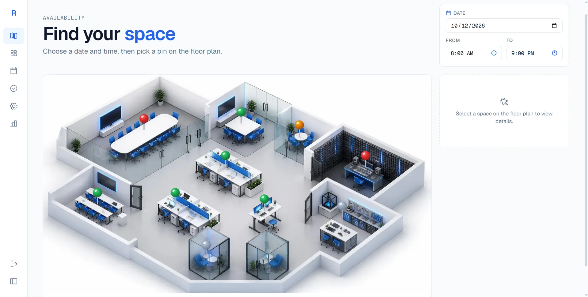
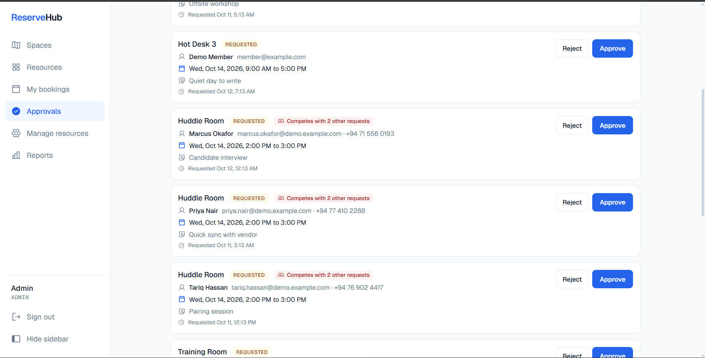
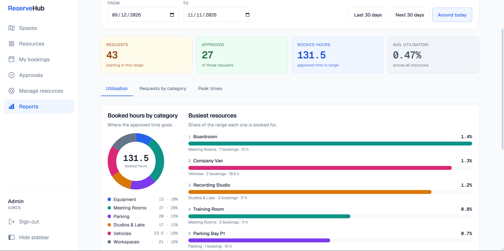
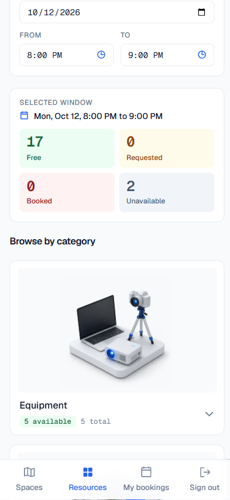

# ReserveHub: Resource Reservation Management System

A web app for booking shared resources (meeting rooms, desks, equipment, vehicles, parking) where
**two people can never hold the same resource at the same time**. Members see what is free on a
floor plan, request a time, and an admin approves or rejects it.

Built for the PrimeWave Lab Software Engineering Internship assessment with Next.js (App Router),
TypeScript and PostgreSQL.

## The idea in one minute

The brief names three pains: scheduling confusion, overlapping reservations, and uncertainty about
what is available. The one that must be *impossible*, not just unlikely, is double booking.

- **The database enforces it.** An exclusion constraint on `reservations` rejects two *approved*
  reservations of one resource with overlapping time ranges. Application checks are only there to
  give friendly messages.
- **Approval runs in a transaction** that locks the resource row first, so concurrent approvals queue
  up instead of racing.
- **It is proven, not claimed.** `npm run test:concurrency` fires 50 simultaneous approvals for the
  same slot and asserts exactly one wins. See [docs/concurrency-proof.png](docs/concurrency-proof.png).

## Screenshots

Taken with the demo data from `npm run seed:demo`.

| Floor plan with live availability | Approval queue with competing requests |
|---|---|
|  |  |
| Pins show each space's state for the chosen date and time. | Competing requests are flagged so the admin knows approving one blocks the others. |

| Usage reports | On a phone |
|---|---|
|  |  |
| Utilisation, requests by category, and peak times for any date range. | The same data on a small screen, with bottom navigation. |

## Features

**Members**
- Floor plan with push pins coloured by availability for any date and time range
- Browse resources by category with live free / requested / booked / unavailable counts
- Request a booking with a purpose, see the status of every request, cancel one
  (approved bookings can be cancelled up to 24 hours before they start)

**Admins**
- Approval queue: approve, reject (optional reason), see competing requests for the same slot
- Cancel an approved booking, with a required reason
- Add, edit and retire resources, and place them on the floor plan by clicking it
- Usage reports for a date range: utilisation per resource, requests by category and status,
  busiest hours and weekdays (heatmap)

## Tech stack

| Layer | Choice |
|---|---|
| Framework | Next.js 16 (App Router, Route Handlers), React 19, TypeScript |
| Database | PostgreSQL 16 in Docker, `pg` driver, plain `.sql` migrations (no ORM) |
| Validation | Zod |
| Auth | bcrypt password hashes, server-side sessions stored as SHA-256 hashes, HttpOnly cookie |
| Styling | Tailwind CSS v4 with design tokens, Geist, Phosphor icons |

## Quick start

**Prerequisites:** Node.js 20 or newer, npm, and Docker Desktop (for PostgreSQL).

```bash
# 1. Install dependencies
npm install

# 2. Create your environment file (the defaults work with the Docker setup below)
cp .env.example .env            # PowerShell: Copy-Item .env.example .env

# 3. Start PostgreSQL (port 5433 on your machine)
docker compose up -d

# 4. Create the tables
npm run migrate

# 5. Load base data: two accounts, six categories, 20 resources with floor plan positions
npm run seed

# 6. (Recommended) Load demo data: six more people and about 40 reservations in every status
npm run seed:demo

# 7. Run the app
npm run dev
```

Open <http://localhost:3000>.

### Demo accounts

| Role | Email | Password |
|---|---|---|
| Admin | `admin@example.com` | `admin12345` |
| Member | `member@example.com` | `member12345` |

Six more members exist after `npm run seed:demo` (for example `priya.nair@demo.example.com`, same
password `member12345`). Use two browser windows, one private, to be the admin and a member at once.

### A suggested walkthrough

1. Sign in as the member. On **Spaces**, pick a time and click a pin, then request a booking.
2. Open **My bookings** to see it as *Requested*, and try cancelling it.
3. In a private window, sign in as the admin. **Approvals** shows the request. Approve it.
4. Back as the member, the pin is red for that slot and the booking shows *Approved*.
5. As admin, open **Reports** and **Manage resources** (add a resource and click the plan to place it).
6. Look at the Huddle Room on Wednesday: three requests compete, the card says so, and approving the
   second one returns a clear conflict message instead of a double booking.

## Tests and checks

```bash
npm run lint                 # ESLint
npx tsc --noEmit             # type check
npm run test:concurrency     # needs `npm run dev` running; fires 50 parallel approvals
```

The concurrency test creates its own reservations, asserts exactly one `200` and `49` conflicts with
no server errors, then deletes its rows. Set `KEEP=1` to leave them for inspection.

The database rule can also be checked on its own in SQL. The script rolls everything back:

```bash
docker compose exec -T db psql -U reservations -d reservations < db/tests/overlap.sql
```

On PowerShell: `Get-Content db/tests/overlap.sql | docker compose exec -T db psql -U reservations -d reservations`

## Project layout

```
db/migrations/        numbered SQL migrations, applied in order by scripts/migrate.mjs
db/tests/overlap.sql  the exclusion constraint, tested in plain SQL
scripts/              migrate, seed, seed:demo, concurrency test
src/app/              pages (App Router) and API route handlers under src/app/api
src/components/       UI components
src/lib/              database access, auth, validation, and the reservation rules
docs/                 problem interpretation, decision log, ER diagram, progress notes
public/               floor plan and category illustrations
```

## API overview

| Method and path | Who | Purpose |
|---|---|---|
| `POST /api/auth/register`, `login`, `logout`; `GET /api/auth/me` | anyone / signed in | Accounts and session |
| `GET /api/availability?start&end` | member | State of every resource for a time window |
| `GET /api/resources`, `GET /api/resources/:id` | member | Resource details |
| `POST /api/resources`, `PATCH /api/resources/:id` | admin | Add, edit, retire (status `retired`) |
| `GET /api/categories` | member | Categories for forms |
| `GET /api/reservations?status&mine=1` | member (own) / admin (all) | List reservations |
| `POST /api/reservations` | member | Request a booking |
| `POST /api/reservations/:id/approve`, `reject` | admin | Decide a request |
| `POST /api/reservations/:id/cancel` | owner or admin | Cancel (admin must give a reason) |
| `GET /api/admin/reports?from&to&tz` | admin | The report data |

Errors use consistent status codes: `400` invalid input, `401` not signed in, `403` wrong role,
`404` not found (also used for other people's reservations, so ids cannot be probed),
`409` conflict (overlap, wrong state, cut-off).

## Design decisions

Every significant choice is written down with the options considered and the trade-off accepted in
[docs/DECISIONS.md](docs/DECISIONS.md). The ones a reviewer is most likely to ask about:

- **D4**: overlap prevention is a database exclusion constraint plus a row lock in the transaction
- **D5**: raw SQL with `pg` and plain migrations, so the constraint is visible and reviewable
- **D14**: database-backed sessions with a hand-rolled login, and why role is never read from the client
- **D20**: availability is computed in SQL and exposes state only, never who booked
- **D22**: resources are retired, not deleted, so booking history and reports stay correct

The problem interpretation and scope tiers are in [docs/PROBLEM.md](docs/PROBLEM.md), and the ER
diagram source is [docs/er-diagram.dbml](docs/er-diagram.dbml).

## Known limitations

Stated plainly, because they are choices and not oversights:

- **No quantity per resource.** Each physical unit (Projector 1, Projector 2) is its own resource.
  Counting overlapping units cannot be enforced by a simple constraint (D3).
- **Exclusive reservations only, no capacity.** A booking holds the whole resource. An unbooked
  shared space is simply free for anyone to use; walk-ins are not tracked.
- **No email or SMS notifications**, and no recurring bookings. Status is shown in the app.
- **No rate limiting, email verification or password reset.** Out of scope for this exercise.
- **Registration reveals whether an email is already taken** (a duplicate returns a clear error).
- **Demo passwords are in the seed scripts.** They are for local use only.
- **One floor plan.** Pin positions are percentages of one image, so multiple floors would need a
  `floor` column (D21).
- **Reports use a calendar range** and treat every hour as available, so utilisation looks low
  against a 24-hour day. The busiest-resource ranking compares resources with each other.
- **`npm run seed:demo` resets all reservations.** It refuses to run when `NODE_ENV=production`.

## What I would do next

Working-hours aware utilisation, a day timeline in the booking panel, email notifications, a
"walk-in, no booking needed" flag for open spaces, and rate limiting on login.
